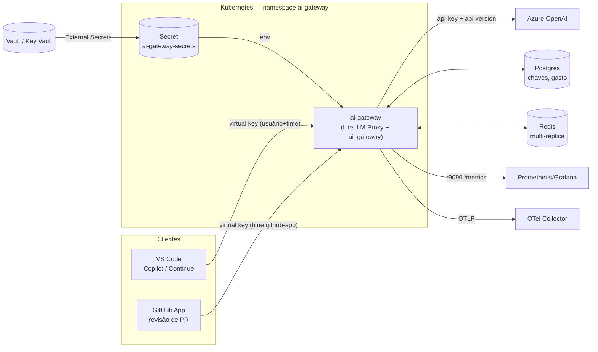

# AI Gateway — LiteLLM + Azure OpenAI

Gateway LLM corporativo em Python: o [LiteLLM](https://github.com/BerriAI/litellm) é usado
**como biblioteca** (pacote fixado e verificado por hash), estendido com código próprio e
empacotado num container para Kubernetes.

- **Azure OpenAI** com deployments, endpoint e versão da API configuráveis por ambiente.
- **Chave da Azure vinda do vault** (HashiCorp Vault ou Azure Key Vault) como variável de ambiente.
- **Virtual keys por usuário e por time**, com orçamento em camadas (time → membro → usuário → chave),
  reset periódico, limites de RPM/TPM e modelos permitidos por time.
- **Observabilidade**: métricas Prometheus (custo por time/usuário/chave/cliente), log de auditoria
  JSON, traces OpenTelemetry, dashboard Grafana e alertas de orçamento.
- **Pronto para consumo** no VS Code (Copilot Chat, Continue, Cline) e por um GitHub App de exemplo.



## Estrutura

| Caminho | Conteúdo |
|---|---|
| `config/config.yaml` | Config do LiteLLM: deployments Azure, roteamento, orçamentos padrão, callbacks |
| `src/ai_gateway/` | Código Python: entrypoint/bootstrap, políticas, auditoria de custo, SDK e CLI de admin |
| `provisioning/tenants.yaml` | Times, usuários e orçamentos como código (`gatewayctl apply`) |
| `deploy/k8s/` | Kustomize: `base`, componentes (`vault-*`, `redis`, `observability`, `expose-*`) e overlays `local`/`prod` |
| `clients/vscode/` | Configurações para Copilot Chat (Custom Endpoint), Continue e afins |
| `clients/github-app/` | GitHub App de revisão de PR que consome o gateway |
| `tests/` | Unitários, E2E e um mock da API da Azure OpenAI |

## Início rápido (local, sem custo)

Requer Docker. O mock da Azure responde no lugar da API real.

```bash
make up                                   # gateway + Postgres + mock da Azure
make seed                                 # cria times, usuários e orçamentos
export LITELLM_MASTER_KEY=sk-local-master-key  # master key da stack local
.venv/bin/gatewayctl key create --team platform --user alice --alias alice-vscode --client vscode

curl http://localhost:4000/v1/chat/completions \
  -H "Authorization: Bearer sk-<chave-gerada>" -H "Content-Type: application/json" \
  -d '{"model": "gpt-5.4", "messages": [{"role": "user", "content": "oi"}]}' -i | grep -i x-litellm-response-cost

make up-obs     # + Prometheus :9091, Grafana :3000 (dashboard "AI Gateway") e Jaeger :16686
make test-integration
```

Para usar a Azure de verdade localmente, copie `.env.example` para `.env` e preencha.

## Deployments da Azure OpenAI

Cada deployment fica em `config/config.yaml`; endpoint e versão da API vêm do ambiente:

```yaml
- model_name: gpt-5.4                       # nome que os clientes usam
  litellm_params:
    model: azure/gpt-5.4                    # azure/<nome do deployment no Azure>
    api_base: os.environ/AZURE_API_BASE     # https://<recurso>.openai.azure.com
    api_version: os.environ/AZURE_API_VERSION   # ex.: 2025-04-01-preview, ou "v1"
    api_key: os.environ/AZURE_API_KEY       # do vault
  model_info:
    base_model: azure/gpt-5.4               # obrigatório para calcular custo na Azure
```

- `AZURE_API_BASE` e `AZURE_API_VERSION` são definidos por overlay
  (`deploy/k8s/overlays/prod/kustomization.yaml`), então cada ambiente aponta para o seu recurso.
- **`base_model` é obrigatório**: o nome do deployment na Azure é livre, e sem ele o LiteLLM não
  sabe o preço — o gasto seria registrado como zero e nenhum orçamento funcionaria.
- Para deployments em recursos/regiões diferentes, use variáveis distintas
  (ex.: `os.environ/AZURE_API_BASE_EASTUS`). O entrypoint valida no boot que toda variável
  referenciada existe.
- Os modelos ficam dentro da imagem (config como código, versionado junto com o código).
  Mudou o `config.yaml`? Nova imagem, novo rollout.

## Segredos e vault

O pod recebe os segredos como variáveis de ambiente a partir do Secret `ai-gateway-secrets`,
que o [External Secrets Operator](https://external-secrets.io) sincroniza do vault:

| Variável | Conteúdo |
|---|---|
| `AZURE_API_KEY` | Chave da Azure OpenAI |
| `LITELLM_MASTER_KEY` | Master key do gateway (`sk-...`), só para administração |
| `LITELLM_SALT_KEY` | Chave de criptografia de credenciais no banco — defina uma vez, nunca troque |
| `DATABASE_URL` | Postgres (ex.: Azure Database for PostgreSQL) |
| `REDIS_PASSWORD` | Opcional, com o componente `redis` |

- `components/vault-hashicorp`: KV v2 + autenticação Kubernetes (instruções no arquivo).
- `components/vault-azure-keyvault`: Azure Key Vault + Workload Identity (sem credencial estática).
- Sem ESO? O entrypoint também aceita `<VAR>_FILE` (ex.: `AZURE_API_KEY_FILE=/vault/secrets/azure`),
  compatível com Vault Agent Injector e Secrets Store CSI Driver.
- **Rotação**: o ESO atualiza o Secret a cada `refreshInterval`; com o
  [Reloader](https://github.com/stakater/Reloader) instalado, os pods reiniciam sozinhos
  (a anotação já está no Deployment).
- Segredo faltando = o pod não sobe (`CreateContainerConfigError` ou erro claro no boot), em vez
  de falhar na primeira requisição.

## Virtual keys, times e orçamento

Cada requisição passa por todas as camadas; a primeira que estourar bloqueia com
**HTTP 429 `budget_exceeded`** até o próximo reset (`budget_duration`):

| Camada | Onde se define | Exemplo |
|---|---|---|
| Time | `teams[].max_budget` | Platform: 500 USD / 30d |
| Membro no time | `teams[].members[].max_budget_in_team` | Alice no Platform: 60 USD |
| Usuário (todas as chaves) | `users[].max_budget` | Alice: 60 USD / 30d |
| Chave | `gatewayctl key create --max-budget` | alice-vscode: 25 USD |

```bash
export GATEWAY_URL=http://localhost:4000 LITELLM_MASTER_KEY=...
gatewayctl apply -f provisioning/tenants.yaml --dry-run   # mostra o diff
gatewayctl apply -f provisioning/tenants.yaml             # idempotente
gatewayctl key create --team platform --user alice --alias alice-vscode --client vscode
gatewayctl key list --team platform
gatewayctl spend                                          # gasto x orçamento por time e membro
gatewayctl key delete alice-vscode
```

Controles adicionais (em `config/config.yaml` e no hook de políticas):

- `default_key_generate_params`: orçamento/validade aplicados a chaves criadas sem valores explícitos.
- `upperbound_key_generate_params`: tetos que nenhuma chave pode ultrapassar.
- `max_internal_user_budget`: orçamento padrão de usuários criados sem orçamento.
- `apply_user_budget_to_team_keys`: o orçamento pessoal vale também para as chaves de time.
- `GATEWAY_REQUIRE_TEAM=true`: chave sem time é recusada (403) — todo gasto tem dono.
- `GATEWAY_MAX_OUTPUT_TOKENS`: teto de tokens de saída por requisição (limita o custo de uma chamada).
- Modelos por time: o time `github-app` só acessa `gpt-5.4-mini`.

> O orçamento é verificado **antes** de cada requisição, então a chamada que cruza o limite é
> concluída e só as seguintes são bloqueadas. Com várias réplicas, habilite o Redis (componente
> `redis`) para que o gasto seja compartilhado em tempo real entre os pods.

## Observabilidade

| Sinal | Onde | Destaques |
|---|---|---|
| Métricas LiteLLM | `:9090/metrics/` | `litellm_spend_metric_total`, `litellm_remaining_team_budget_metric`, latência, TTFT, tokens, estado dos deployments |
| Métricas do gateway | `:9090/metrics/` | `ai_gateway_spend_usd_total{client,team,model}` — custo por **cliente** (vscode, github-app…) |
| Auditoria | stdout (JSON, `"event": "llm_request"`) | usuário, time, chave, cliente, modelo, tokens, custo, latência — **sem prompt/resposta** |
| Traces | OTLP (`OTEL_EXPORTER_OTLP_ENDPOINT`) | spans com modelo, tokens e custo (`gen_ai.*`); conteúdo das mensagens desligado |
| Dashboard | `components/observability/dashboards/ai-gateway.json` | custo por time/cliente, uso do orçamento, top usuários/chaves, erros, latência |
| Alertas | `components/observability/prometheusrule.yaml` | orçamento de time >90% e esgotado, pico de gasto, 5xx, deployment Azure fora, TTFT alto |

A porta de métricas é separada da API e não é exposta pelo Ingress/HTTPRoute.

## Deploy no Kubernetes

Pré-requisitos: External Secrets Operator; Postgres gerenciado; opcionalmente Prometheus
Operator/kube-prometheus-stack, Redis gerenciado e um Gateway API (ou Ingress) controller.

1. Grave os segredos no vault (comandos em `deploy/k8s/components/vault-*/kustomization.yaml`).
2. Ajuste `deploy/k8s/overlays/prod/` (valores `change-me`): endpoint e versão da Azure, host,
   servidor do vault, Redis, OTLP e tag/digest da imagem. Escolha os componentes de vault e exposição.
3. Aplique e acompanhe:

   ```bash
   kubectl apply -k deploy/k8s/overlays/prod
   kubectl -n ai-gateway get externalsecret      # SecretSynced = True
   kubectl -n ai-gateway rollout status deploy/ai-gateway
   ```

4. Provisione times e usuários pela rede interna (a API de administração não é pública):

   ```bash
   kubectl -n ai-gateway port-forward svc/ai-gateway 4000:4000
   gatewayctl apply -f provisioning/tenants.yaml
   ```

O que o overlay entrega: 2–10 réplicas (HPA), PDB, spread por nó/zona, Pod Security `restricted`,
usuário não-root, filesystem somente leitura, NetworkPolicy, probes de startup/readiness/liveness,
migrações do banco no boot (LiteLLM usa lock no Postgres) e apenas `/v1` exposto publicamente.

Teste local num cluster real: `make kind-up` (kind + overlay `local` com Postgres e mock no cluster).

## Consumindo

- **VS Code**: [`clients/vscode/README.md`](clients/vscode/README.md) — Copilot Chat (Custom Endpoint), Continue, Cline/Roo.
- **GitHub App**: [`clients/github-app/README.md`](clients/github-app/README.md) — revisão automática de PRs.
- **Qualquer SDK OpenAI**:

  ```python
  from openai import OpenAI

  client = OpenAI(base_url="https://ai-gateway.example.com/v1", api_key="sk-<virtual-key>")
  client.chat.completions.create(model="gpt-5.4-mini", messages=[{"role": "user", "content": "oi"}])
  ```

- **SDK de administração** (Python):

  ```python
  from ai_gateway.admin import GatewayAdmin

  with GatewayAdmin("http://localhost:4000", master_key) as gw:
      gw.ensure_team("data", max_budget=300, budget_duration="30d", models=["gpt-5.4-mini"])
      gw.ensure_user("carol", email="carol@example.com", max_budget=40, budget_duration="30d")
      gw.ensure_team_member("data", "carol", max_budget_in_team=40, budget_duration="30d")
      key = gw.generate_key(
          user_id="carol", team_id="data", key_alias="carol-vscode", metadata={"client": "vscode"}
      )["key"]
  ```

## Desenvolvimento

```bash
make dev            # virtualenv com o lockfile
make lint test      # ruff + testes unitários
make k8s-validate   # kustomize build + kubeconform (inclui CRDs)
make lock           # regenera requirements.lock (uv) após mudar dependências
```

O CI (`.github/workflows/ci.yaml`) roda lint, testes unitários, validação dos manifests, E2E com
docker compose e, em `main`/tags, publica as imagens multi-arquitetura no GHCR com SBOM e proveniência.

### Atualizando o LiteLLM

A versão é fixada em `pyproject.toml` e todas as dependências são verificadas por hash
(`pip install --require-hashes`). Para atualizar: altere a versão, rode `make lock`, leia o
changelog e rode `make test-integration`.

## Limitações conhecidas

- O papel **admin de time** (delegar gestão de chaves a um líder) é recurso do LiteLLM Enterprise;
  aqui a administração é centralizada via `gatewayctl`/master key.
- Copilot Business/Enterprise exige que a organização permita BYOK para usar o Custom Endpoint.
- Os preços usados no cálculo de custo vêm da tabela embutida na versão do LiteLLM; ao usar
  preços negociados com a Microsoft, defina `input_cost_per_token`/`output_cost_per_token` no
  `litellm_params` do deployment.

## Licença

MIT
